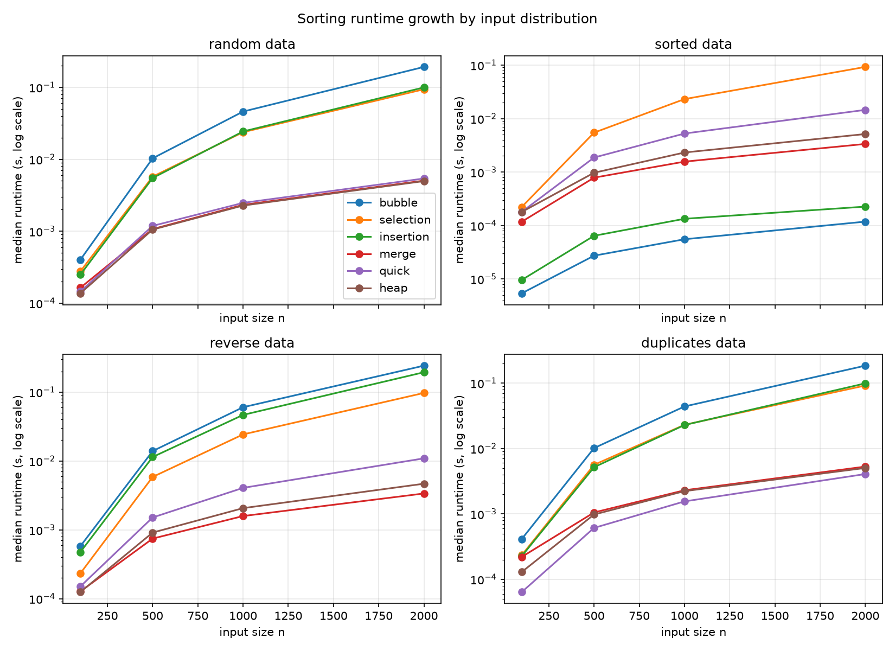

# Lab 11 - Sorting Algorithms and Performance Benchmarks

CPEPRO8L - Data Structures and Algorithms

## Objectives
1. Implement Bubble Sort, Selection Sort, Insertion Sort, Merge Sort, Quick Sort, and Heap Sort without built-in sorting functions.
2. Verify correctness using empty, one-item, duplicate, already sorted, reverse-sorted, and random datasets.
3. Measure and compare execution time across input sizes and data distributions.
4. Relate the measured behavior to expected time and space complexity.

## Environment
- Operating system: Windows
- Python 3.14
- `matplotlib` (installed with `pip install matplotlib`) for the chart
- Other modules: standard library only (`csv`, `time`, `random`, `statistics`, `unittest`)

## Execution commands
Run these from inside the `lab11_sorting_benchmarks` folder:

```bash
python test_sorts.py              # correctness tests (must be clean first)
python benchmark_sorts.py         # writes results.csv and comparison_chart.png
python quick_sort_diagnostic.py   # supports guide question 6
```

## Method and fairness controls
- Sizes: 100, 500, 1000, 2000. Distributions: random, sorted, reverse, duplicates.
- Every algorithm runs 3 trials per (size, distribution); the **median** is reported.
- Every function returns `(sorted_list, comparisons, movements)`. A swap counts as 3 movements and a shift or placement as 1, for all six algorithms.

Fairness controls:
1. **Same data for every algorithm:** each (distribution, size) dataset is generated once from a fixed seed and reused by all six algorithms.
2. **Fresh copy per trial:** each timed run gets its own `list(source)`, so no run sees data touched by an earlier run.
3. **Setup excluded from timing:** dataset generation, copying, and the correctness check happen outside the timer; only the sort call is timed.
4. **Same clock:** `time.perf_counter()` for every measurement.
5. **Repeated trials, median reported:** reduces the effect of background noise.
6. **Correctness checked on every run:** a wrong result stops the benchmark.
7. **Skips recorded:** none were needed, because the quadratic sorts ran at every size (see `results.csv`, `note` column).

## Results (n = 2000, median of 3 trials)

Runtime in milliseconds:

| Algorithm | Random | Sorted | Reverse | Duplicates |
|---|---|---|---|---|
| Bubble | 191.97 | 0.12 | 241.72 | 184.15 |
| Selection | 93.83 | 92.39 | 97.07 | 91.57 |
| Insertion | 99.64 | 0.23 | 194.00 | 98.76 |
| Merge | 5.05 | 3.35 | 3.37 | 5.28 |
| Quick | 5.40 | 14.54 | 10.90 | 4.06 |
| Heap | 4.97 | 5.14 | 4.67 | 5.03 |

Comparisons / movements:

| Algorithm | Random | Sorted | Reverse | Duplicates |
|---|---|---|---|---|
| Bubble | 1,998,964 / 3,086,586 | 1,999 / 0 | 1,999,000 / 5,997,000 | 1,997,725 / 3,063,282 |
| Selection | 1,999,000 / 5,976 | 1,999,000 / 0 | 1,999,000 / 3,000 | 1,999,000 / 5,955 |
| Insertion | 1,030,853 / 1,030,861 | 1,999 / 1,999 | 1,999,000 / 2,000,999 | 1,023,087 / 1,023,093 |
| Merge | 19,474 / 21,952 | 10,864 / 21,952 | 11,088 / 21,952 | 19,387 / 21,952 |
| Quick | 35,162 / 51,339 | 106,461 / 146,946 | 80,463 / 106,512 | 25,545 / 42,735 |
| Heap | 37,707 / 60,357 | 39,159 / 63,900 | 35,964 / 56,124 | 37,731 / 60,402 |

Full data for all sizes is in `results.csv`.



Growth check: doubling n from 1000 to 2000 multiplied the runtime of Bubble, Selection, and Insertion Sort by about 4 on the data where they do full work (3.9 to 4.3), and the runtime of Merge, Quick, and Heap Sort by about 2.1 to 2.8. This matches O(n^2) and O(n log n) growth.

## Guide question answers

**1. Which elementary algorithm benefited most from already sorted data, and why?**
Bubble Sort benefited most in runtime (191.97 ms on random data down to 0.12 ms on sorted data), with Insertion Sort close behind (99.64 ms down to 0.23 ms). Bubble Sort stops after one pass when no swaps happen, so it does only 1,999 comparisons and 0 movements. Insertion Sort compares each item once with its left neighbor and never shifts anything (1,999 comparisons). Selection Sort did not benefit at all: it always makes 1,999,000 comparisons to find each minimum, so it took about 92 ms on sorted data versus about 94 ms on random data.

**2. How did the Quick Sort pivot strategy affect sorted or duplicate-heavy data?**
The pivot is the median of the first, middle, and last items, with a three-way partition (less than, equal to, greater than the pivot). On sorted and reverse data the median-of-three pivot avoids the classic O(n^2) collapse: Quick Sort needed 106,461 comparisons instead of about 2 million. On duplicate-heavy data the items equal to the pivot are not sorted again, so Quick Sort was the fastest of all six algorithms (4.06 ms, 25,545 comparisons). An earlier version of my Quick Sort used a two-way partition, and it hit Python's recursion limit on lists where every value was equal; the three-way partition fixed that.

**3. Why is median runtime preferable to a single timing result?**
A single timing can be inflated by other programs running, operating system scheduling, or garbage collection. The median ignores an unusually slow or fast run, and unlike the mean it is not pulled by one outlier. With only 3 trials, the median can tolerate one bad run but not two, so more trials would give a more reliable value.

**4. What memory trade-off does Merge Sort make compared with in-place alternatives?**
Merge Sort builds new lists for the slices and merged results at each level, so it needs O(n) auxiliary space. Heap Sort, Bubble Sort, Selection Sort, and Insertion Sort need O(1) extra space, and my Quick Sort needs only O(log n) stack space. In exchange, Merge Sort has guaranteed O(n log n) time and is stable. Its movement count was 21,952 in every distribution, and it was the fastest algorithm on sorted and reverse data (about 3.35 ms).

**5. When might an O(n^2) algorithm still be reasonable?**
When the input is small or nearly sorted. At n = 100 on random data all six algorithms finished in under 0.41 ms, so the difference is negligible. On sorted data Insertion Sort was far faster than Merge, Quick, and Heap Sort (0.23 ms versus 3.35 ms or more at n = 2000, and 0.01 ms versus 0.118 ms or more at n = 100). Selection Sort also performs very few movements (5,976 on random data versus 60,357 for Heap Sort), which can matter when writing data is expensive.

**6. Which measured result differed most from the theoretical expectation, and what likely caused it?**
Quick Sort was 2 to 3 times slower on sorted data (14.54 ms) and reverse data (10.90 ms) than on random data (5.40 ms), and slower than Merge and Heap Sort there, even though the median-of-three pivot is meant to prevent poor behavior on ordered input. Its runtime also grew by about 2.8 times from n = 1000 to n = 2000 on sorted data, compared with about 2.2 times for the other O(n log n) sorts. `quick_sort_diagnostic.py` shows the cause on the same n = 2000 data: the partition steps scanned 54,466 elements on sorted data versus 21,723 on random data, and the average split balance was 0.096 on sorted data versus 0.314 on random data (0.5 would be perfectly even halves). So the splits were more lopsided than expected. A likely reason is that the three-way partition swaps items into the upper part of the range, which scrambles the order of that part; the first, middle, and last items are then a poorer estimate of the median in later calls. I did not test that explanation directly. A smaller difference: Bubble Sort was slower than Selection and Insertion Sort on random data even though all three are O(n^2), because it makes about 3.1 million movements versus 5,976 for Selection Sort.

## Conclusion
The measurements match the expected complexity. The quadratic algorithms grew about 4 times when n doubled, and Merge, Quick, and Heap Sort grew about 2 to 3 times. Input order mattered a great deal for Bubble and Insertion Sort (nearly linear on sorted data) and not at all for Selection Sort. Merge Sort and Heap Sort were the most consistent across distributions, Merge Sort at the cost of O(n) extra memory. Quick Sort was fastest on duplicate-heavy data thanks to the three-way partition, but its pivot strategy still produced uneven splits on sorted and reverse data. Limitations: results come from one Windows machine, only 3 trials per condition, and sizes only up to 2000.

## Files submitted
- `sorting_algorithms.py` - the six sorting algorithms with comparison and movement counters
- `test_sorts.py` - correctness tests
- `benchmark_sorts.py` - benchmark driver; produces `results.csv` and `comparison_chart.png`
- `quick_sort_diagnostic.py` - supports guide question 6
- `results.csv` - raw benchmark data
- `comparison_chart.png` - runtime growth chart
- `README.md` - this report
