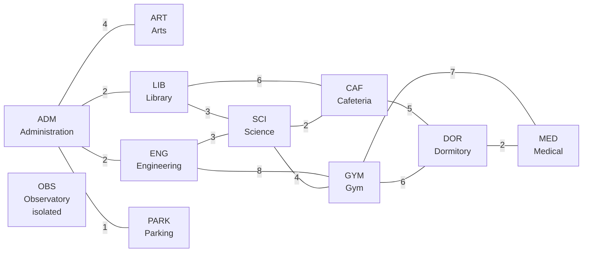

# Lab 12 - Graph Traversals and Shortest-Path Routing

CPEPRO8L - Data Structures and Algorithms
First Semester, AY 2026-2027

## 1. Objectives

1. Represent unweighted and weighted graphs using adjacency lists.
2. Implement and trace Breadth-First Search (BFS) and Depth-First Search (DFS).
3. Implement Dijkstra's single-source shortest-path algorithm with a priority
   queue (`heapq`).
4. Verify traversal and shortest-path results with hand traces, manual weight
   sums, and independent automated tests.

## 2. Environment

- Operating system: Windows
- Python 3.14.7 (any Python 3.11+ works)
- Standard library only: `collections`, `heapq`, `math`, `random`, `unittest`
- No third-party packages required

## 3. Note on the graph dataset

The handout refers to an instructor-supplied graph or campus-routing scenario,
but no dataset file was attached. This submission therefore encodes a
representative **campus walking-time graph** in `graph.py` (`CAMPUS_VERTICES`
and `CAMPUS_EDGES`). It deliberately contains every case the lab asks for:

- a cycle (SCI-CAF-DOR-GYM-SCI),
- an isolated vertex (OBS, the Observatory),
- an unreachable target from ADM (OBS),
- equal-cost alternative paths (ADM->SCI and ADM->CAF),
- a case where fewest edges is not least time (ADM->MED).

If the instructor provides a specific dataset, replace the edge table in
`graph.py`; no algorithm or test change is needed.

## 4. Files submitted

| File | Purpose |
|---|---|
| `graph.py` | Adjacency-list graph model (directed/undirected, weighted/unweighted), validation, campus dataset |
| `traversals.py` | BFS, recursive DFS, explicit-stack DFS, traces, path helpers |
| `dijkstra.py` | Dijkstra with `heapq`, distances, predecessors, path reconstruction, equal-cost paths |
| `test_graph.py` | 33 automated tests, including randomized cross-checks against independent references |
| `demo.py` | Generates all evidence and writes `routing_results.txt` |
| `routing_results.txt` | Captured program output (edge table, traces, routing table, invalid-input evidence) |
| `hand_traces.md` | BFS/DFS/Dijkstra hand traces and manual weight verification |
| `README.md` | This report |

## 5. Execution commands

Run from inside `lab12_graph_routing`:

```bash
python -m unittest test_graph -v    # 33 tests; must print OK
python demo.py                      # prints evidence, writes routing_results.txt
python graph.py                     # prints graph and edge table
python traversals.py                # prints BFS/DFS orders from ADM and GYM
python dijkstra.py                  # prints shortest paths from ADM
```

## 6. Task A - Graph model and dataset validation

### 6.1 Representation

The graph is stored as an adjacency list:

```
vertex -> [(neighbor, weight), ...]
```

- **Undirected** edges are inserted in both directions with the same weight.
- **Unweighted** graphs store a weight of `1` for every edge and reject any
  other weight.
- **Directed** graphs insert only the requested direction. A directed demo
  graph is included to prove this.
- **Neighbour order** is always ascending vertex label. This is the approved
  deterministic ordering rule used by both traversals.
- **Validation** (`Graph.validate()`) checks that every referenced neighbour
  exists, that undirected edges are symmetric, that there are no duplicate
  neighbours, and that all weights are valid.

Invalid input is rejected at insertion:

- negative weights -> `ValueError`
- duplicate edges -> `ValueError`
- non-unit weight on an unweighted graph -> `ValueError`
- non-numeric weight -> `ValueError`
- unknown start/source vertex -> `ValueError`

### 6.2 Graph diagram



The Mermaid block renders on GitHub. The same information as an edge table:

### 6.3 Edge table (undirected; weight = walking minutes)

| Edge | Minutes | Edge | Minutes |
|---|---:|---|---:|
| ADM-ART | 4 | LIB-SCI | 3 |
| ADM-ENG | 2 | ENG-SCI | 3 |
| ADM-LIB | 2 | LIB-CAF | 6 |
| ADM-PARK | 1 | SCI-CAF | 2 |
| CAF-DOR | 5 | ENG-GYM | 8 |
| SCI-GYM | 4 | GYM-DOR | 6 |
| GYM-MED | 7 | DOR-MED | 2 |

Vertices: 11. Edges: 14. `OBS` is isolated (no edges).

### 6.4 Adjacency list (as produced by the program)

```
ADM   -> ART(4), ENG(2), LIB(2), PARK(1)
ART   -> ADM(4)
CAF   -> DOR(5), LIB(6), SCI(2)
DOR   -> CAF(5), GYM(6), MED(2)
ENG   -> ADM(2), GYM(8), SCI(3)
GYM   -> DOR(6), ENG(8), MED(7), SCI(4)
LIB   -> ADM(2), CAF(6), SCI(3)
MED   -> DOR(2), GYM(7)
OBS   -> (isolated)
PARK  -> ADM(1)
SCI   -> CAF(2), ENG(3), GYM(4), LIB(3)
```

### 6.5 Dataset validation

`build_campus_graph()` calls `validate()` after construction. In addition,
`test_campus_vertices_and_edges` independently checks that all 11 vertices and
all 14 undirected edges (both directions) appear with the correct weights.

## 7. Task B - BFS and DFS traversals

### 7.1 Implementation

- `bfs(graph, start)` uses `collections.deque` as a FIFO queue and a visited
  set. Vertices are marked visited when enqueued, so each is enqueued once.
  It returns traversal order, parent tree, and hop distance.
- `dfs_recursive(graph, start)` uses recursion.
- `dfs_iterative(graph, start)` uses an explicit stack, pushing neighbours in
  reverse order so the smallest label is popped first. It marks vertices
  visited when popped and takes the parent from the stack entry, which
  reproduces the recursive tree exactly.
- `bfs_trace`, `dfs_recursive_trace`, and `dfs_trace` record queue/stack state
  for the hand traces.

### 7.2 Traversal results from two starting vertices

From **ADM**:

```
BFS: ADM -> ART -> ENG -> LIB -> PARK -> GYM -> SCI -> CAF -> DOR -> MED
DFS: ADM -> ART -> ENG -> GYM -> DOR -> CAF -> LIB -> SCI -> MED -> PARK
```

From **GYM**:

```
BFS: GYM -> DOR -> ENG -> MED -> SCI -> CAF -> ADM -> LIB -> ART -> PARK
DFS: GYM -> DOR -> CAF -> LIB -> ADM -> ART -> ENG -> SCI -> PARK -> MED
```

Both traversals reach 10 of the 11 vertices. `OBS` is isolated and is never
reached. The full step-by-step BFS queue trace and DFS call-stack trace are in
`hand_traces.md` and in `routing_results.txt`.

### 7.3 BFS vs DFS behaviour

- BFS processes all vertices at hop distance `d` before any at `d + 1`. It is
  level-by-level and finds minimum-edge paths.
- DFS follows one branch to the end before backtracking. It is deep and narrow.
- On the campus graph the BFS tree is shallow (max 3 hops) while the DFS tree
  is deep (up to 6 levels from GYM).

### 7.4 Program vs hand trace

The hand traces in `hand_traces.md` were produced from the same neighbour
ordering rule and match the program output in `routing_results.txt` exactly
for both start vertices. The recursive and explicit-stack DFS agree on the
campus graph and on randomized graphs (tested).

## 8. Task C - Dijkstra shortest paths

### 8.1 Implementation

`dijkstra(graph, source)`:

1. Rejects unknown sources and any negative edge weight.
2. Initializes every distance to `math.inf` and every predecessor to `None`.
3. Pushes `(0, counter, source)` onto a `heapq` priority queue.
4. Repeatedly pops the smallest tentative distance. Stale entries left by
   lazy deletion are skipped.
5. Relaxes each outgoing edge: if `d + w < dist[v]`, update `dist[v]`,
   set `prev[v] = u`, and push the new entry.
6. Returns distances, predecessors, and the settle order.

`path_to(target)` walks `prev` backwards to reconstruct the path.
`all_shortest_paths` follows only tight edges (`dist[u] + w == dist[v]`) to
enumerate equal-cost alternatives.

### 8.2 Routing table from ADM

| Target | Minutes | Hops | Path |
|---|---:|---:|---|
| ART | 4 | 1 | ADM -> ART |
| CAF | 7 | 3 | ADM -> ENG -> SCI -> CAF |
| DOR | 12 | 4 | ADM -> ENG -> SCI -> CAF -> DOR |
| ENG | 2 | 1 | ADM -> ENG |
| GYM | 9 | 3 | ADM -> ENG -> SCI -> GYM |
| LIB | 2 | 1 | ADM -> LIB |
| MED | 14 | 5 | ADM -> ENG -> SCI -> CAF -> DOR -> MED |
| OBS | unreachable | - | - |
| PARK | 1 | 1 | ADM -> PARK |
| SCI | 5 | 2 | ADM -> ENG -> SCI |

`OBS` is correctly reported as unreachable (`inf`, path `None`). Running
Dijkstra with `OBS` as the source reaches only `OBS` itself.

### 8.3 Manual verification (sum of edge weights)

**ADM -> MED = 14 minutes**

```
ADM -> ENG -> SCI -> CAF -> DOR -> MED
  2  +   3  +   2  +   5  +   2   = 14
```

Equal-cost alternative:
`ADM -> LIB -> SCI -> CAF -> DOR -> MED = 2 + 3 + 2 + 5 + 2 = 14`.

The BFS route `ADM -> ENG -> GYM -> MED = 2 + 8 + 7 = 17` is **not** shortest.

**ADM -> GYM = 9 minutes**

```
ADM -> ENG -> SCI -> GYM = 2 + 3 + 4 = 9
ADM -> LIB -> SCI -> GYM = 2 + 3 + 4 = 9   (equal cost)
ADM -> ENG -> GYM        = 2 + 8     = 10  (not shortest)
```

### 8.4 Equal-cost alternatives

```
ADM -> SCI: 2 paths of cost 5
  ADM -> ENG -> SCI
  ADM -> LIB -> SCI

ADM -> CAF: 2 paths of cost 7
  ADM -> ENG -> SCI -> CAF
  ADM -> LIB -> SCI -> CAF
```

The program reports the first path found under deterministic tie-breaking;
`all_shortest_paths` proves that the alternative has the same cost.

### 8.5 Rejected / unsupported cases

| Case | Handling |
|---|---|
| Negative edge weight | Rejected at `add_edge` and re-checked by `dijkstra` -> `ValueError` |
| Non-unit weight on unweighted graph | Rejected -> `ValueError` |
| Duplicate edge | Rejected -> `ValueError` |
| Unknown source vertex | Rejected -> `ValueError` |
| Unreachable target | `dist = inf`, `path = None`, listed by `unreachable()` |

Dijkstra is invalid for negative edges because it permanently settles a vertex
when it is the smallest in the queue. A later negative edge could lower the
distance of an already-settled vertex, so the greedy assumption is false.

## 9. Task D - Integrated routing analysis

### 9.1 BFS tree vs weighted shortest-path tree

| Vertex | BFS hops | BFS path | Dijkstra minutes | Dijkstra path |
|---|---:|---|---:|---|
| ART | 1 | ADM -> ART | 4 | ADM -> ART |
| CAF | 2 | ADM -> LIB -> CAF | 7 | ADM -> ENG -> SCI -> CAF |
| DOR | 3 | ADM -> ENG -> GYM -> DOR | 12 | ADM -> ENG -> SCI -> CAF -> DOR |
| ENG | 1 | ADM -> ENG | 2 | ADM -> ENG |
| GYM | 2 | ADM -> ENG -> GYM | 9 | ADM -> ENG -> SCI -> GYM |
| LIB | 1 | ADM -> LIB | 2 | ADM -> LIB |
| MED | 3 | ADM -> ENG -> GYM -> MED | 14 | ADM -> ENG -> SCI -> CAF -> DOR -> MED |
| OBS | unreachable | - | unreachable | - |
| PARK | 1 | ADM -> PARK | 1 | ADM -> PARK |
| SCI | 2 | ADM -> ENG -> SCI | 5 | ADM -> ENG -> SCI |

The trees agree for nearest buildings and diverge when edge weights matter.
For MED, BFS minimizes hops (3 edges, 17 minutes) while Dijkstra minimizes
time (5 edges, 14 minutes). This is the central Task D result.

### 9.2 Required edge-case tests

| Case | Test data | Expected | Observed | Status |
|---|---|---|---|---|
| Isolated vertex | OBS (no edges) | Not reached by BFS/DFS; `inf` in Dijkstra | Correct | PASS |
| Cycle | 5-vertex ring A-B-C-D-E (`test_cycle_visits_each_vertex_once`); the campus graph also contains the cycle SCI-CAF-DOR-GYM-SCI, which every campus run traverses | BFS, recursive DFS and iterative DFS each visit all 5 vertices exactly once and terminate | 5 vertices, no repeats, all three algorithms | PASS |
| Equal-cost alternatives | ADM->SCI | Exactly 2 paths, both cost 5 | Correct | PASS |
| Unreachable target | ADM->OBS | `inf`, path `None`, listed unreachable | Correct | PASS |
| Directed graph | ADM->LIB one-way | Reverse edge does not exist | Correct | PASS |
| Negative weight | A->B = -3 | `ValueError` | Correct | PASS |

### 9.3 Expected vs observed test table (full suite)

`python -m unittest test_graph -v` -> `Ran 33 tests ... OK`.

| # | Test class | Test | Expected | Observed | Status |
|---:|---|---|---|---|---|
| 1 | TestGraphModel | `test_campus_vertices_and_edges` | 11 vertices, 14 edges; every `CAMPUS_EDGES` entry present in both directions with the listed weight; `validate()` is True | All 11 vertices and 14 edges present, weights match | PASS |
| 2 | TestGraphModel | `test_adjacency_lists_are_sorted` | ADM, SCI, MED, OBS adjacency lists in ascending neighbour order (OBS empty) | Lists identical to expected | PASS |
| 3 | TestGraphModel | `test_undirected_symmetry` | `weight(v,u) == weight(u,v)` for every campus edge | Symmetric for all 14 edges | PASS |
| 4 | TestGraphModel | `test_directed_edges_are_one_way` | ADM->LIB exists; LIB->ADM and ADM->GYM do not | As expected | PASS |
| 5 | TestGraphModel | `test_unweighted_graph_uses_unit_weights` | Every edge weight is 1; 14 edges | All weights 1, 14 edges | PASS |
| 6 | TestGraphModel | `test_duplicate_and_invalid_edges_rejected` | `ValueError` for duplicate A-B, reversed duplicate B-A, weight -1, weight "heavy" | 4 x `ValueError` | PASS |
| 7 | TestGraphModel | `test_unweighted_rejects_non_unit_weight` | `ValueError` for weight 5 on an unweighted graph | `ValueError` raised | PASS |
| 8 | TestGraphModel | `test_self_loop_is_handled` | Self-loop A->A (weight 0) accepted, counted once, graph validates | edge_count = 1, validate() True | PASS |
| 9 | TestGraphModel | `test_isolation_and_contains` | OBS in graph with no neighbours; ZZZ not in graph | OBS present with `[]`; ZZZ absent | PASS |
| 10 | TestTraversals | `test_bfs_order_and_hops_from_adm` | Order ADM, ART, ENG, LIB, PARK, GYM, SCI, CAF, DOR, MED; hops, parents as in hand trace; OBS absent | Order, hops and parents match | PASS |
| 11 | TestTraversals | `test_bfs_order_from_gym` | GYM, DOR, ENG, MED, SCI, CAF, ADM, LIB, ART, PARK | Match | PASS |
| 12 | TestTraversals | `test_dfs_order_from_adm` | Order ADM, ART, ENG, GYM, DOR, CAF, LIB, SCI, MED, PARK; MED's parent is DOR | Order and parent tree match | PASS |
| 13 | TestTraversals | `test_dfs_order_from_gym` | GYM, DOR, CAF, LIB, ADM, ART, ENG, SCI, PARK, MED | Match | PASS |
| 14 | TestTraversals | `test_dfs_iterative_matches_recursive_on_campus` | Same order, parent and depth from ADM, GYM, SCI, OBS | Identical for all 4 starts | PASS |
| 15 | TestTraversals | `test_dfs_iterative_matches_recursive_on_random_graphs` | Same order and parent on 24 random unweighted graphs (undirected and directed), 2 starts each | 48 of 48 comparisons identical | PASS |
| 16 | TestTraversals | `test_bfs_minimum_edge_path` | ADM->MED = ADM, ENG, GYM, MED (3 hops) on the unweighted campus graph | Path and 3 hops match | PASS |
| 17 | TestTraversals | `test_unknown_start_raises` | `ValueError` for start ZZZ in BFS, both DFS versions and Dijkstra | 4 x `ValueError` | PASS |
| 18 | TestTraversals | `test_traversals_do_not_modify_graph` | Adjacency identical before and after BFS, DFS x2, Dijkstra | Unchanged | PASS |
| 19 | TestTraversals | `test_cycle_visits_each_vertex_once` | 5-cycle: each of BFS, recursive DFS, iterative DFS visits all 5 vertices once | 5 distinct vertices each | PASS |
| 20 | TestDijkstra | `test_distances_from_adm` | ADM=0, PARK=1, ENG=2, LIB=2, ART=4, SCI=5, CAF=7, GYM=9, DOR=12, MED=14, OBS=inf | All match | PASS |
| 21 | TestDijkstra | `test_settle_order_is_deterministic` | ADM, PARK, ENG, LIB, ART, SCI, CAF, GYM, DOR, MED | Match | PASS |
| 22 | TestDijkstra | `test_path_reconstruction` | Reconstructed path to each of the 9 reachable targets equals the hand-verified path | 9 of 9 match | PASS |
| 23 | TestDijkstra | `test_path_cost_equals_sum_of_weights` | Sum of edge weights along each path equals reported distance | Equal for every reachable vertex | PASS |
| 24 | TestDijkstra | `test_manual_verification_two_paths` | ADM->MED = 14 via ENG, SCI, CAF, DOR; ADM->GYM = 9 via ENG, SCI | 14 and 9, paths match | PASS |
| 25 | TestDijkstra | `test_unreachable_and_isolated_vertex` | From ADM: OBS has `inf`, path `None`, listed by `unreachable()` | As expected | PASS |
| 26 | TestDijkstra | `test_isolated_source` | From OBS: only OBS reachable (dist 0); other 10 unreachable | Reachable = [OBS], 10 unreachable | PASS |
| 27 | TestDijkstra | `test_equal_cost_alternatives` | ADM->SCI has exactly 2 paths (via ENG, via LIB), both cost 5 | 2 paths, cost 5 each | PASS |
| 28 | TestDijkstra | `test_no_path_returns_empty_alternatives` | `all_shortest_paths` ADM->OBS returns `[]` | `[]` | PASS |
| 29 | TestDijkstra | `test_negative_weight_rejected_by_dijkstra` | `dijkstra` raises `ValueError` when a -5 edge is forced into the structure | `ValueError` raised | PASS |
| 30 | TestDijkstra | `test_unit_weight_dijkstra_equals_bfs_hops` | On unit weights Dijkstra distance equals BFS hops; OBS = inf | Equal for all vertices | PASS |
| 31 | TestDijkstra | `test_bfs_tree_differs_from_weighted_tree` | MED: BFS 3 hops via GYM; Dijkstra 14 min via ENG, SCI, CAF, DOR | 3 hops (17 min) vs 14 min, paths differ | PASS |
| 32 | TestDijkstra | `test_dijkstra_matches_bellman_ford_on_random_graphs` | Same reachability and distances as an independent Bellman-Ford on 32 random 10-vertex graphs (directed/undirected x weighted/unweighted) | 32 of 32 graphs match at every vertex | PASS |
| 33 | TestDijkstra | `test_directed_graph_distances` | Directed demo from ADM: ADM=0, LIB=1, ENG=2, SCI=3, GYM=4 | Match | PASS |

All 33 tests are listed above in the order they appear in `test_graph.py`.

### 9.4 Complexity

With an adjacency-list representation (`V` vertices, `E` edges):

| Algorithm | Time | Extra space | Why |
|---|---|---|---|
| BFS | O(V + E) | O(V) | Each vertex enqueued once; each adjacency list scanned once |
| DFS | O(V + E) | O(V) | Each vertex/edge visited once; recursion/stack depth up to V |
| Dijkstra (binary heap, lazy deletion) | O((V + E) log V) | O(V + E) | Each edge may push a heap entry; heap ops are O(log V) |

Graph storage itself is O(V + E). An adjacency matrix would need O(V^2) space
and O(V^2) time for BFS/DFS/Dijkstra, which is wasteful for this sparse graph
(11 vertices, 14 edges).

### 9.5 Which algorithm for which job

- **Unweighted reachability** (is a building reachable at all): BFS or DFS,
  both O(V + E).
- **Minimum-edge paths** (fewest corridors/roads, all edges equal): BFS.
- **Weighted routing** (fastest walking time, non-negative weights):
  Dijkstra with a heap.
- **Negative weights**: neither BFS nor Dijkstra; use Bellman-Ford (not part
  of this lab's required implementation, but used as the test reference).
- **Cycle detection / topological-style deep exploration**: DFS.

## 10. Guide question answers

**1. How does the queue make BFS behaviour different from DFS stack
behaviour?**
A queue is FIFO, so the vertex discovered earliest is processed next. BFS
therefore finishes an entire hop level before moving deeper, producing a
shallow, wide traversal tree and minimum-edge distances. A stack is LIFO, so
the most recently discovered vertex is processed next. DFS therefore follows
one branch as far as possible before backtracking, producing a deep, narrow
tree. On the campus graph, BFS from ADM visits ART, ENG, LIB, PARK (all one
hop) first, while DFS from ADM goes ADM -> ART, backtracks, then ADM -> ENG ->
GYM -> DOR -> CAF -> LIB -> SCI before returning to MED and PARK.

**2. Why must neighbour order be defined before comparing traversal
results?**
Traversal output depends on the order neighbours are examined. Sorting,
insertion order, hash order, and reverse-alphabetical order all produce
different but equally valid BFS/DFS orders and trees. To compare a hand trace
with program output, to compare two implementations, and to make results
reproducible across runs and machines, the ordering rule must be fixed first.
This lab uses ascending vertex label in `Graph.neighbors()` everywhere.

**3. Under what condition can BFS produce a shortest path, and what does it
minimize?**
BFS produces a shortest path when the graph is unweighted or all edges have
equal weight. It minimizes the number of edges (hops), not the sum of weights.
On a weighted graph BFS still gives the minimum-hop path, which may be more
expensive in total weight. Example: ADM -> MED is 3 hops but 17 minutes via
BFS, versus 5 hops but 14 minutes via Dijkstra.

**4. Why is Dijkstra's algorithm invalid for graphs with negative edge
weights?**
Dijkstra settles a vertex permanently when it is popped with the smallest
tentative distance, assuming no future path can improve it. A negative edge
can create a later path that lowers the distance of an already-settled vertex,
so that assumption fails and the final distances can be wrong. Negative cycles
make shortest paths undefined. This implementation rejects negative weights at
insertion and re-checks them before running Dijkstra.

**5. What is the benefit of storing predecessor information with distances?**
Distances alone give the cost but not the route. The predecessor map lets the
program reconstruct the actual path from any target back to the source, define
the shortest-path tree, verify paths by summing weights, compare BFS and
Dijkstra trees, and enumerate equal-cost alternatives. Without predecessors a
second search would be needed to recover directions.

**6. How do adjacency lists affect the complexity of BFS, DFS, and Dijkstra?**
Adjacency lists use O(V + E) space and store only real edges. BFS and DFS scan
each adjacency list once, so both run in O(V + E) time. Dijkstra with a binary
heap does O(log V) work per heap operation and may push once per edge, giving
O((V + E) log V) time (commonly written O(E log V)) and O(V + E) space. An
adjacency matrix would use O(V^2) space and make each traversal O(V^2), which
is much worse for sparse graphs like this campus graph.

**7. Which test case gave the strongest evidence that the routing
implementation is correct?**
The randomized cross-check `test_dijkstra_matches_bellman_ford_on_random_graphs`
is the strongest evidence. It compares every vertex distance and reachability
between this Dijkstra implementation and an independent Bellman-Ford reference
on 32 random graphs spanning directed/undirected and weighted/unweighted
variants. It exercises many topologies rather than one hand-picked example and
would catch subtle relaxation or predecessor errors. The concrete campus checks
strengthen it: ADM->SCI has exactly two equal-cost paths of cost 5, and every
reconstructed path's edge weights sum to its reported distance (for example
ADM->MED = 2 + 3 + 2 + 5 + 2 = 14).

## 11. Conclusion

The adjacency-list model correctly represents all 11 campus vertices and 14
undirected weighted edges, supports directed and unweighted variants, and
rejects invalid input (negative weights, duplicate edges, non-unit weights,
unknown vertices). BFS and DFS produce deterministic, verified orders from two
starting vertices; the recursive and explicit-stack DFS agree exactly. BFS
finds minimum-hop paths, while Dijkstra correctly finds minimum-time routes and
reconstructs them through stored predecessors. Dijkstra also identifies the
isolated/unreachable OBS vertex and equal-cost alternatives. Automated testing
(33 tests) and manual weight sums confirm correctness, and the measured
behaviour matches the expected O(V + E) complexity for BFS/DFS and
O((V + E) log V) for heap-based Dijkstra.

Limitations: the dataset is a representative campus graph because no
instructor dataset was supplied, and the equal-cost enumeration uses a
depth-first walk over the shortest-path DAG (small graphs only).
